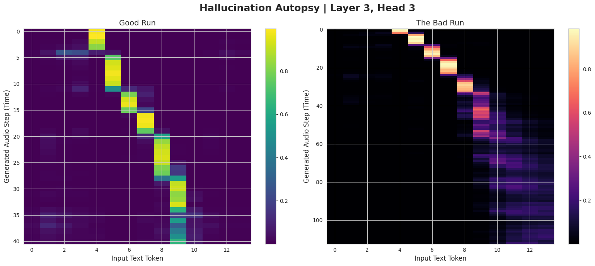

I've been working on finetuning autoregressive text to speech models for almost a year now, and there's a lot of lesson I've learnt along the way. Instead of writing about how to train models, I've taken a bit of interest in interpreting and understanding how model works internally. This post will be my trial to try my best to explain what happens in the back when we generate speech from tokens. We will explore the phenomenon in which an autoregressive TTS model hallucinates.

Autoregressive text-to-speech (TTS) models can sound fluent until they don’t. In practice, they sometimes produce outputs like:

| reference: saya tak pasti mana nak pergi
| output: saya saya saya tak pasti…

This kind of failure is often called *hallucination*. But that label doesn’t explain much. Why does a model suddenly start repeating tokens? Why does it ignore the input and “free run” on its own outputs?

In this post, we take a mechanistic approach to this question. Instead of treating hallucination as a black-box failure, we analyze the model’s internal states during decoding and ask:

* Can hallucination be detected *before* it happens?
* Does it correspond to a specific region in hidden state space?
* Can we *induce* or *prevent* it by intervening on the model?

Inspired by anthropic's interpretability work on large language models, we can explain hallucination in autoregressive TTS is not random, it is a structured and, to some extent, controllable internal phenomenon.

## Is hallucination causally encoded in the model?

In this experiment we will observe the difference between hallucination and normal internal states in a model. We will record model's direction in hidden state for both cases.

Let's first identify activation in three different cases

- repetition
- skipping
- normal

---
